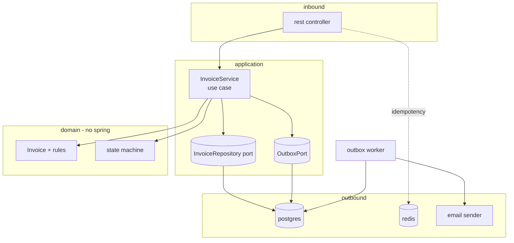
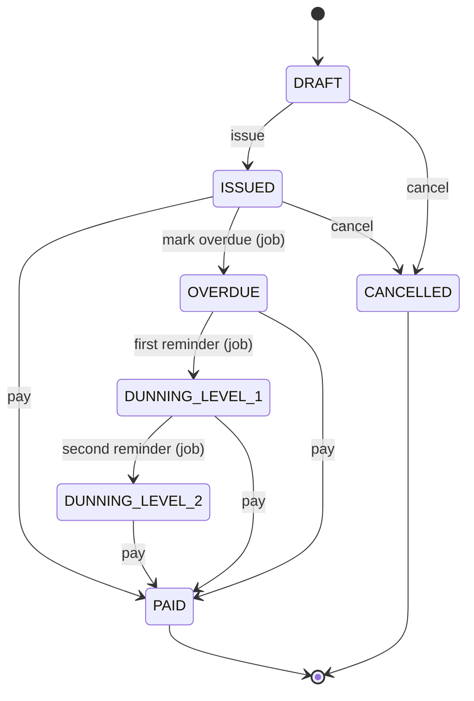

# mahnflow

A small B2B backend for invoicing and automatic dunning (German: *Mahnwesen*).
Backend only, no frontend, you interact with it via curl / Postman / Swagger.

> Learning / portfolio project. I wanted something closer to real B2B software
> than another todo-list CRUD app, so I picked a topic that basically every SaaS
> company in Germany has to solve: billing and chasing late payments. I'm still
> a junior, so there are rough edges, and I list them openly in
> **Bekannte Probleme / TODOs** at the bottom instead of hiding them.

---

## Update, October 2026

I came back to this project after finishing my thesis. The first version was
written to learn the application side (state machine, idempotency, outbox).
Now I want to learn the other half: what it takes to run a service like this
for real, meaning reproducible builds, a hardened container, security scans in
CI, running more than one instance, and later Kubernetes and a cloud setup.

What changed so far:

- **Reproducible build:** Maven Wrapper (`./mvnw`) pinned to Maven 3.9.16, used
  by CI and by the Dockerfile, so everyone builds with the same Maven.
- **Docker image:** `.dockerignore`, build through the wrapper, and the app now
  runs as a non-root user (UID 10001) with the JVM sized from the container's
  memory limit.
- **Dependency security:** Trivy scans the image in CI and the build fails on
  new HIGH or CRITICAL findings. The first scan found 51 issues, all coming from
  an outdated Spring Boot 3.3.2. Upgrading to 3.5.16 and pinning Tomcat, Jackson,
  Netty and the Postgres driver to patched versions brought it to zero. Two
  `spring-webmvc` CVEs can only be fixed by Spring Framework 7 (Spring Boot 4).
  They are accepted on purpose in [`.trivyignore`](.trivyignore) with a reason
  and an expiry date, because this app uses neither XSLT views nor SSE.
- **Outbox is safe with several instances:** the worker now locks the rows it
  takes with `SELECT ... FOR UPDATE SKIP LOCKED`. I first wrote a test that
  starts two workers at once and saw it fail (a job was sent twice), then fixed
  it. Details in the outbox row of the concepts table below.
- **Test setup:** Testcontainers upgraded to 1.21.4, because the old version
  could not talk to current Docker versions.

---

## Why this project

I wanted to work as a software developer in Germany. Reading job ads, I kept running
into two terms I never learned at university: **Mahnwesen** (the legal-ish,
escalating process of reminding a customer that an invoice is overdue) and
**GoBD** (German bookkeeping and tax rules).

So instead of another CRUD demo I built a small but *correct* version of that.
The interesting part isn't the REST endpoints, it's the boring-but-hard stuff
underneath: not creating an invoice twice on a retry, never allowing an illegal
state change, and sending mails without blocking the request. Those are the
things I wanted to learn by actually building them, not just reading about them.

---

## What it does

- Create an invoice (`DRAFT`), issue it, take payment, or cancel it.
- A scheduled job marks invoices `OVERDUE` after the due date passes.
- The same job pushes overdue invoices to reminder level 1, then level 2.
- Each reminder becomes an email job that is sent asynchronously.

Every state change goes through a state machine, so an illegal move (paying a
draft, un-paying an invoice) is simply rejected.

---

## Concepts I focused on

| Topic | What I wanted to learn | Where |
|------|------------------------|-------|
| **Idempotency** | a retried "create" must not produce two invoices | `idempotency/IdempotencyService.java` |
| **State machine** | model the invoice life cycle so illegal moves are impossible | `statemachine/InvoiceStateMachineConfig.java` |
| **Outbox pattern** | send mails async without losing them or blocking the transaction; several workers must not send the same job twice (`SKIP LOCKED`) | `outbox/OutboxWorker.java`, `OutboxWorkerConcurrencyTest.java` |
| **Optimistic locking** | two racing updates, one fails instead of silently overwriting | `@Version` in `InvoiceEntity.java` |
| **Hexagonal layout** | keep the domain free of Spring imports | `domain/` package |
| **Testcontainers** | test against real Postgres + Redis, not H2 | `AbstractIntegrationTest.java` |

I don't claim these are perfect, but I can explain *why* each one is there, which
was the whole point.

---

## Architecture

Hexagonal / clean-ish layout: the domain in the middle knows nothing about
Spring, Postgres or HTTP, and everything points inward. Probably not 100%
textbook, but close enough for a proof of concept.



### Invoice life cycle (the state machine)



---

## Why these tech choices

I didn't pick these because they're fancy. I picked them because they fit the
problem and I wanted to learn them. The longer versions are in
[`docs/adr`](docs/adr).

- **Postgres, not H2 (even in tests)** — "works on H2, breaks on Postgres" is a
  classic trap (different SQL, different locking). Since this is about money, I
  want the tests to run against the real database, so I use Testcontainers.
  Slower tests, but honest ones.
- **State machine instead of if-else** — my first version was a growing pile of
  `if (status == ...)` and got ugly fast. With Spring StateMachine I define the
  allowed moves once, and an illegal move is rejected automatically.
- **Outbox pattern instead of Kafka/RabbitMQ** — for a single service a message
  broker felt like overkill (one more thing to run and understand). The
  transactional outbox gives the same "never lose a message" guarantee with just
  a database table. With several app instances the workers lock the rows they
  take (`FOR UPDATE SKIP LOCKED`), so each job goes to one worker. Delivery is
  still *at least once*: if an instance crashes after sending a mail but before
  its transaction commits, that mail can be sent again.
- **Redis for idempotency keys** — I needed a fast store with a TTL so old keys
  expire on their own.
- **JWT with a shared secret** — a proper setup would use Keycloak, but running a
  full identity provider just to demo the API felt heavy. For now I sign tokens
  with one secret. Dev only, not production. See ADR 0004.

---

## Tech stack

- Java 21, Spring Boot **3.5.x**, built with Maven Wrapper
- Spring Web (blocking MVC — for this CRUD-ish workload WebFlux would just add
  complexity I don't need yet)
- PostgreSQL + Flyway 11 + Spring Data JPA
- Redis (idempotency keys)
- Spring StateMachine 3.2.x
- Spring Security + OAuth2 Resource Server (JWT)
- Micrometer + Prometheus + Grafana
- Testcontainers 1.21 + JUnit 5
- Docker (multi-stage image, non-root)
- GitHub Actions (build and tests, SpotBugs report, JaCoCo coverage, Docker image
  build, Trivy scan that fails on HIGH/CRITICAL findings)

---

## How to run

You only need Docker.

```bash
docker compose up --build
```

This builds the image, then starts the app (`:8080`), Postgres, Redis, Prometheus
(`:9090`) and Grafana (`:3000`). Flyway builds the schema on first start.
Stop everything with `docker compose down`.

Without Docker (needs Java 21 + a local Postgres + Redis). The wrapper downloads
the right Maven for you, so Maven does not need to be installed:

```bash
./mvnw spring-boot:run
```

### Try the API

Get a demo token first (this `/dev/token` endpoint is dev only, off in prod):

```bash
TOKEN=$(curl -s "http://localhost:8080/dev/token?role=ACCOUNTANT" | jq -r .token)
```

Create a draft invoice (note the idempotency key):

```bash
curl -X POST http://localhost:8080/api/invoices \
  -H "Authorization: Bearer $TOKEN" \
  -H "Idempotency-Key: $(uuidgen)" \
  -H "Content-Type: application/json" \
  -d '{"customerId":"11111111-1111-1111-1111-111111111111",
       "amount":250.00,"currency":"EUR","dueDate":"2026-12-31"}'
```

Issue + pay it (use the id from the response):

```bash
curl -X POST http://localhost:8080/api/invoices/<id>/issue -H "Authorization: Bearer $TOKEN"
curl -X POST http://localhost:8080/api/invoices/<id>/pay   -H "Authorization: Bearer $TOKEN"
```

Try a wrong move to see the state machine block it (paying a fresh draft returns
`409 Conflict`):

```bash
curl -i -X POST http://localhost:8080/api/invoices/<new-draft-id>/pay \
  -H "Authorization: Bearer $TOKEN"
```

- Swagger UI: http://localhost:8080/swagger-ui.html (click **Authorize**, paste the token)
- OpenAPI JSON: http://localhost:8080/v3/api-docs

---

## Bekannte Probleme / TODOs (honest list)

I'd rather list these myself than have an interviewer find them. These are the
things I know aren't great yet:

- ⚠️ **Idempotency has a small race window.** I run the action first and only
  then do `setIfAbsent` on the Redis key. Two identical requests in the same
  millisecond can both run before the key is written. The proper fix is to
  reserve the key *first* (a "pending" marker) and let the second one wait.
  On the todo list.
- ⚠️ **The dunning job isn't safe for multiple app instances.** The `@Scheduled`
  job in `DunningJob` runs on every instance, so with two instances both would
  escalate the same invoices. It needs a lock so only one instance runs it
  (ShedLock or a database lock). This is the next one I want to fix before
  running more than one replica.
- **Outbox delivery is at least once, not exactly once.** `SKIP LOCKED` stops two
  workers from taking the same row, but a crash after the mail is sent and before
  the transaction commits sends it again. A real mail provider call would need an
  idempotency key on its side. Also, the mail is sent while the row locks are held,
  which is fine for a log sender but would need rethinking with a slow provider.
- **The state machine builds a fresh machine on every transition.** Works, but I
  haven't load-tested it yet (JMeter is on the list).
- **No real emails.** `LogEmailSender` just logs. Plugging in a real provider
  (or a PDF generator) is the next step.
- **`Customer` is a domain class without a table yet.** I modeled it but didn't
  build the customer CRUD, so for now invoices just carry a `customerId`.
- **Security uses a shared HMAC secret.** Fine for the demo, not for production;
  would move to Keycloak / a real issuer-uri.
- **GoBD compliance is only partial.** Real bookkeeping rules want an immutable
  audit log of every change. I don't have that yet.

If you spot more, please tell me, I'm here to learn.

---

## Testing

```bash
./mvnw verify
```

- `InvoiceDomainTest` — fast unit tests for the domain rules (no Spring).
- `InvoiceApiIntegrationTest` — full HTTP flow against **real** Postgres + Redis
  via Testcontainers. Needs Docker running.
- `OutboxWorkerConcurrencyTest` — starts two outbox workers at the same moment
  and checks that no job is sent twice. It failed before the `SKIP LOCKED` fix.

Coverage report ends up in `target/site/jacoco/index.html`.

Use Java 21 for the build. If Maven picks a different JDK on your machine, set
`JAVA_HOME` first (on macOS: `export JAVA_HOME=$(/usr/libexec/java_home -v 21)`).

---

## Project layout

```
domain/        pure business rules, no spring
application/   use cases + ports (interfaces)
adapter/in/    rest controllers + dto
adapter/out/   postgres, email
statemachine/  invoice state config + transition check
idempotency/   redis based de-dup
outbox/        background worker for async jobs
dunning/       scheduled mahnwesen job
security/      jwt resource server
docs/adr/      architecture decision records
.github/       CI workflow (build, tests, image build, Trivy scan)
Dockerfile     multi-stage build, runs as non-root
.trivyignore   accepted CVEs, each with a reason and an expiry date
```
